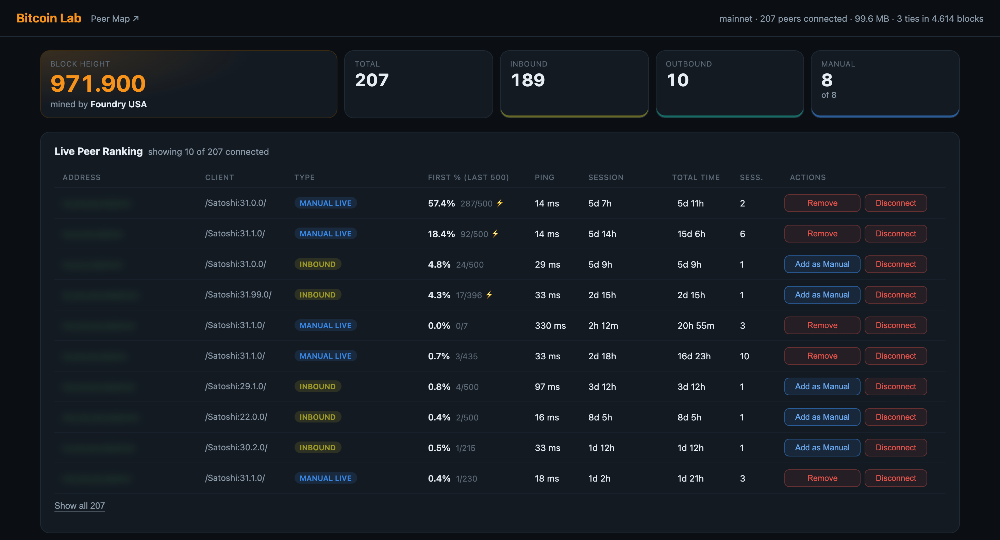
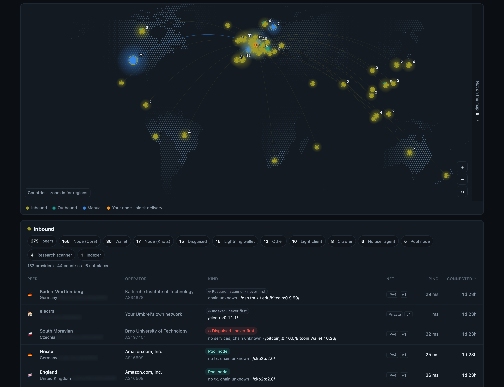

# Bitcoin Peer Lab

Two Umbrel apps for a closer look at your node's peers.

| App | What it does |
|---|---|
| [Bitcoin Lab](https://github.com/benunskilled/bitcoin-lab) | Ranks your peers by who brings new blocks first, and keeps the best as manual peers if you want |
| [Peer Map](https://github.com/benunskilled/peer-map) | Checks what each peer claims against what it really does, and puts them all on a world map |

Use either app on its own or both together. Each requires Umbrel's official **Bitcoin Node** app.

## Bitcoin Lab: who brings blocks first

Every new block reaches your node through one of your peers. Some peers are first again and again, others never. Bitcoin Lab notes for every block who was first and ranks your peers by it. Keep the fast ones as manual peers, drop the ones that never deliver and get fresh ones to rank, or let rotation do it for you.

Mining solo? Stratum Race times how fast your own pool turns a new block into fresh work, side by side with public pools. Rotation and Stratum Race are both off by default.



## Peer Map: who your node is talking to

Your node talks to strangers all day. Each one says what software it runs, but is it telling the truth? Peer Map takes a closer look: what the peer offers, whether it wants your transactions, how often it pings or asks for addresses, which chain it is on. A normal node, a wallet, a crawler, or a spy in disguise? Find out.



## Better together

With both installed, Peer Map follows every new block across your node: which pool mined it, which of your peers brought it first and, if Stratum Race watches your own pool, how long each step to your mining job took. Change your setup and you see whether it gets faster.

## No open port?

Both apps still work. Without an open port your node only has the connections it opens itself, plus whatever reaches it over Tor or I2P. Peer Map has fewer strangers to show, but can still catch a surprise in your outbound slots. Bitcoin Lab helps you most here: once you fill its eight manual slots, your node holds on to the peers that delivered best.

## Install

1. In umbrelOS, open **App Store → ⋮ → Community App Stores**.
2. Add this store URL:

   ```text
   https://github.com/benunskilled/bitcoin-lab-community-store
   ```

3. Install **Bitcoin Lab**, **Peer Map**, or both. Umbrel will offer to install Bitcoin Node first if needed.

Open the apps from Umbrel, or use their dashboard addresses:

| App | Dashboard |
|---|---|
| Bitcoin Lab | `<your-umbrel>:8790` |
| Peer Map | `<your-umbrel>:8791` |

## Source and documentation

This repository contains the Umbrel packaging. Application code and detailed documentation live in the individual repositories:

- [Bitcoin Lab](https://github.com/benunskilled/bitcoin-lab)
- [Peer Map](https://github.com/benunskilled/peer-map)

For packaging and publishing instructions, see [RELEASING.md](RELEASING.md).
