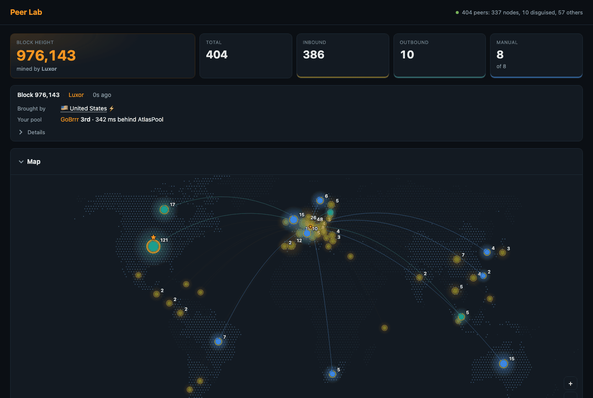

# Bitcoin Peer Lab

One Umbrel app for a closer look at your node's peers: **[Peer Lab](https://github.com/benunskilled/peer-lab)**. It requires Umbrel's official **Bitcoin Node** app.

Your node talks to strangers all day. Each one says what software it runs, but is it telling the truth? Peer Lab takes a closer look: what a peer offers, whether it wants your transactions, which chain it is on. A normal node, a wallet, a crawler, or a spy in disguise? The map shows where they are and who hosts them. For every new block it notes which peer brought it first. Slot Fill puts Core's eight empty manual slots to use for spread, and Stratum Race times how fast your own pool turns a new block into fresh work.

**[Try the live demo →](https://peermap.xyz/)**



## Install

1. In umbrelOS, open **App Store → ⋮ → Community App Stores**.
2. Add this store URL:

   ```text
   https://github.com/benunskilled/peer-lab-store
   ```

3. Install **Peer Lab**. Umbrel will offer to install Bitcoin Node first if needed.

Open it from Umbrel, or at `<your-umbrel>:8797`.

## Source and documentation

This repository contains the Umbrel packaging. Code and documentation live in
[Peer Lab](https://github.com/benunskilled/peer-lab) · [Issues](https://github.com/benunskilled/peer-lab/issues) · [Security](https://github.com/benunskilled/peer-lab/blob/main/SECURITY.md)

For packaging and publishing instructions, see [RELEASING.md](RELEASING.md).

## Older apps

[Bitcoin Lab](https://github.com/benunskilled/bitcoin-lab) and [Peer Map](https://github.com/benunskilled/peer-map) are still in this store but no longer updated; Peer Lab replaces both. To switch, turn off Bitcoin Lab's Slot Fill, install Peer Lab, then uninstall both.
